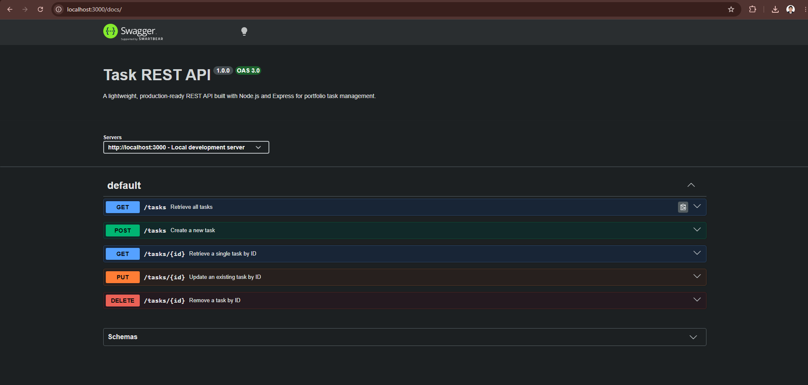
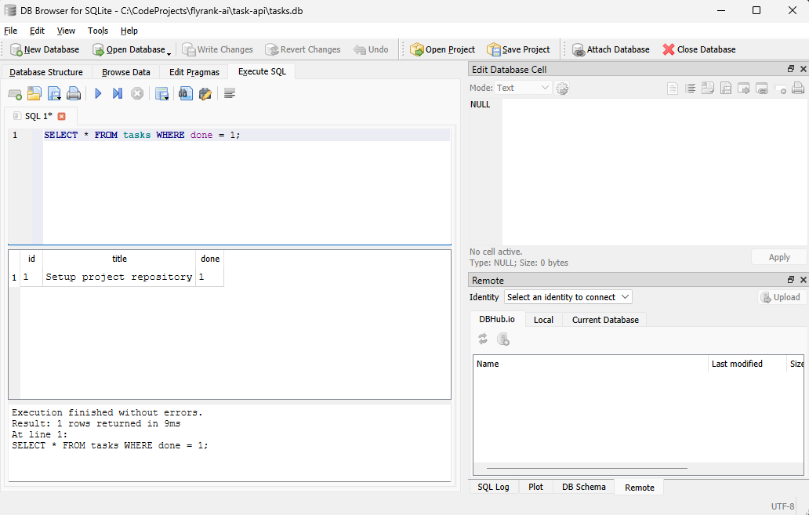

# Task Management REST API

A lightweight, production-ready REST API built using Node.js and the Express framework, containerized with Docker and backed by a PostgreSQL database. This application handles data management through a containerized SQL storage engine, demonstrating RESTful routing architectures, parameterized query safety, environment variable configuration, and automated interactive documentation.

## Features

* **Full CRUD Operations**: Implementations for creating, reading, updating, and deleting tasks persisted directly in PostgreSQL.
* **Containerized Architecture**: Express API and PostgreSQL database run in isolated, orchestration-ready Docker containers.
* **One-Command Execution**: The entire multi-container application stack starts up using Docker Compose.
* **Disk Persistence**: Reliable file-based storage backed by a named Docker volume (`taskdata`) ensuring data survives container restarts.
* **Input Validation**: Robust structural verification for incoming request bodies to prevent malformed data entry.
* **Health Monitoring**: A dedicated endpoint designed to support automated uptime detection hooks.
* **Interactive API Docs**: Integrated OpenAPI specification served visually via Swagger UI.

---

## Technical Architecture

* **Runtime Environment**: Node.js (Alpine Linux container)
* **Application Framework**: Express[cite: 2]
* **Database Engine**: PostgreSQL 16 (Official Docker Image)[cite: 2]
* **Container Orchestration**: Docker Compose[cite: 2]
* **Documentation Standard**: OpenAPI 3.0.0[cite: 2]
* **Data Storage**: Named Docker Volume (`taskdata`)[cite: 2]

---

## Database Architecture and Persistence

### Architectural Decoupling
This project demonstrates clean software layering[cite: 2]. The database storage engine was swapped from an in-memory array (Assignment 1) to SQLite (Assignment 2), and finally to containerized PostgreSQL (Assignment 3)[cite: 2]. Because the database logic is encapsulated inside a dedicated repository module (`db.js`), the application routes, HTTP methods, status codes, and JSON response shapes remained completely unchanged[cite: 2].

### Why PostgreSQL in Docker?
PostgreSQL was selected as a production-grade relational database engine[cite: 2]. Running PostgreSQL inside Docker eliminates local installation steps and prevents version mismatch issues across different development environments[cite: 2].

### Environment Variables and Secrets
Sensitive database credentials and connection parameters are kept entirely out of source control[cite: 2]:
* Credentials are stored in a local `.env` file, which is explicitly ignored by Git[cite: 2].
* A template file named `.env.example` is committed to the repository so developers know which environment variables to define[cite: 2].

### Table Schema
* `id`: SERIAL PRIMARY KEY[cite: 2]
* `title`: TEXT NOT NULL[cite: 2]
* `done`: BOOLEAN NOT NULL DEFAULT FALSE[cite: 2]

---

## Installation and Setup

Follow these steps to configure and run the full application stack using Docker.

### 1. Configure Environment Variables
Copy the committed example environment file to create your local environment configuration[cite: 2]:
```bash
cp .env.example .env
```

### 2. Start the Stack
Launch both the Express API and PostgreSQL containers together with a single command:
```bash
docker compose up --build
```

To stop the application stack while keeping all stored data safe on your named volume:
```bash
docker compose down
```

## API Documentation

### Endpoints Overview

| Method | Endpoint | Description | Status Codes |
| :--- | :--- | :--- | :--- |
| **GET** | `/` | Retrieve API metadata layout | 200 OK |
| **GET** | `/health` | Check application operational status | 200 OK |
| **GET** | `/tasks` | Retrieve all stored tasks from PostgreSQL | 200 OK |
| **GET** | `/tasks/:id` | Fetch an individual task by its unique numeric ID | 200 OK, 404 Not Found |
| **POST** | `/tasks` | Create a new task in PostgreSQL with validation rules | 201 Created, 400 Bad Request |
| **PUT** | `/tasks/:id` | Perform structural updates on a specific task in PostgreSQL | 200 OK, 400 Bad Request, 404 Not Found |
| **DELETE** | `/tasks/:id` | Remove a specific task row from PostgreSQL | 204 No Content, 404 Not Found |

### Interactive Swagger UI Dashboard

The interactive API documentation interface can be viewed directly in your web browser at the following address while the server is running:  
[http://localhost:3000/docs](http://localhost:3000/docs)



### Database Verification

Below is a snapshot of the database state verified via `psql` running inside the active PostgreSQL Docker container:



### Sample Request Verification Output

Below is a verified example log displaying the headers and body payload returned by the server when fetching tasks from the containerized PostgreSQL database:

```plaintext
HTTP/1.1 200 OK
X-Powered-By: Express
Content-Type: application/json; charset=utf-8
Content-Length: 177
Date: Sat, 25 Jul 2026 10:30:00 GMT
Connection: keep-alive
Keep-Alive: timeout=5

[
  {"id":1,"title":"Setup project repository","done":true},
  {"id":2,"title":"Design REST API routing","done":false},
  {"id":3,"title":"Integrate Swagger documentation","done":false}
]
```
